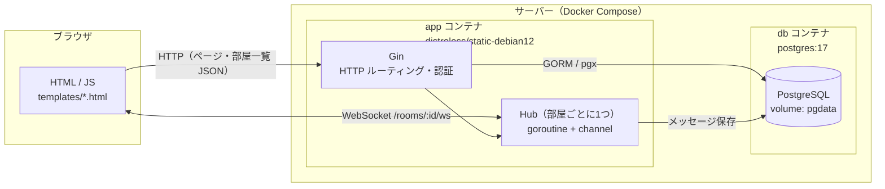
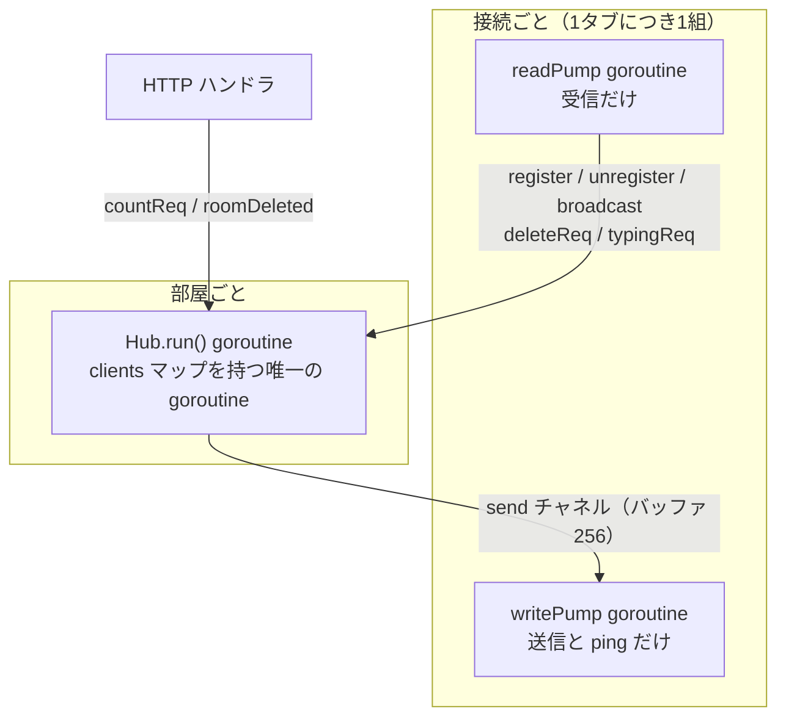
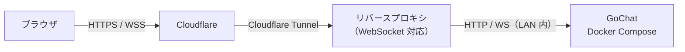
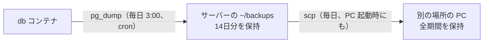

# GoChat

Go 製のリアルタイムチャットアプリケーションです。部屋（ルーム）ごとに WebSocket でメッセージをやり取りします。

ハッカソンや友人との短期チーム開発で、期間中の作業部屋として使うことを目指しています。

## 機能

- ユーザー登録、ログイン、ログアウト（bcrypt でパスワードをハッシュ化し、Cookie セッションで管理）
- 部屋の作成、一覧表示（在室人数つき）、削除（作成者のみ）
- 部屋ごとのリアルタイムチャット（WebSocket）
- チャット履歴の保存と、入室時の履歴表示
- 自分のメッセージの削除
- タイピングインジケーター
- 在室人数の表示
- 連投対策のレート制限（1接続あたり 0.5 秒に1通）
- 部屋が削除されたとき、在室中のユーザーをホームに戻す通知

## システム構成



- 本番では、この前段に Cloudflare Tunnel とリバースプロキシを置いて HTTPS で公開しています（詳しくは「本番環境」を参照）
- app と db は Compose の内部ネットワークでつながります。DB のポート 5432 はホストに公開していません

## 動作環境とバージョン

### 実行環境（Docker）

| 項目 | バージョン・イメージ | 備考 |
|------|------|------|
| Docker Engine | 20.10 以上を推奨 | Compose v2（`docker compose` コマンド）が必要 |
| ビルド用イメージ | `golang:1.25` | マルチステージビルドの1段目。実行時には使わない |
| 実行用イメージ | `gcr.io/distroless/static-debian12` | シェルなしの最小イメージ。`nonroot` ユーザーで実行する |
| データベース | `postgres:17` | 公式イメージ |
| CPU アーキテクチャ | amd64 / arm64 | どちらのイメージも両方に対応している |

### 必要なリソースの目安

| 項目 | 目安 |
|------|------|
| メモリ | 1GB 以上（ビルド時に Go のコンパイルで一時的に多く使う） |
| ディスク | 5GB 以上（イメージ約 1.5GB とビルドキャッシュ、DB データ） |
| ネットワーク | 外向きの HTTPS が通ること（イメージ取得と Cloudflare Tunnel のため） |

### Go と主なライブラリ（`go.mod`）

| 役割 | ライブラリ | バージョン |
|------|-----------|-----------|
| 言語 | Go | 1.25.5 |
| Web フレームワーク | github.com/gin-gonic/gin | v1.12.0 |
| セッション | github.com/gin-contrib/sessions（cookie ストア） | v1.0.4 |
| WebSocket | github.com/gorilla/websocket | v1.5.3 |
| ORM | gorm.io/gorm | v1.31.1 |
| PostgreSQL ドライバ | gorm.io/driver/postgres（内部で jackc/pgx/v5 v5.6.0） | v1.6.0 |
| パスワードハッシュ | golang.org/x/crypto（bcrypt） | v0.48.0 |
| .env 読み込み | github.com/joho/godotenv | v1.5.1 |

フロントエンドはフレームワークを使わず、素の HTML、CSS、JavaScript で書いています。

## ディレクトリ構成

```
GoChat/
├── chat.go              # main 関数、ルーティング、WebSocket の受け付け
├── hub.go               # 部屋ごとの Hub と、接続ごとの readPump / writePump
├── auth.go              # 登録、ログイン、ログアウト、認証ミドルウェア
├── models.go            # DB モデル。init() で DB に接続し AutoMigrate する
├── templates/           # HTML（home, chat, login, register, logout）
├── static/css/          # CSS（home.css, chat.css）
├── scripts/             # 運用スクリプト（DB のバックアップと取得）
├── Dockerfile           # マルチステージビルド
├── docker-compose.yml   # app と db をまとめて起動
├── .dockerignore        # .env などをイメージに入れないための設定
└── .env                 # 環境変数（Git 管理外。自分で作る）
```

## コンテナ構成（`docker-compose.yml`）

| サービス | イメージ | ポート | 再起動 | 備考 |
|---------|---------|-------|-------|------|
| `app` | `Dockerfile` からビルド | `4001:4001`（ホストに公開） | `unless-stopped` | `db` のヘルスチェックが通ってから起動する |
| `db` | `postgres:17` | 公開しない（内部の 5432 のみ） | `unless-stopped` | `pg_isready` で 5 秒ごとにヘルスチェック |

| ボリューム | マウント先 | 中身 |
|-----------|-----------|------|
| `pgdata` | `/var/lib/postgresql/data` | DB のデータ。コンテナを作り直しても残る |

アプリはテンプレートと CSS をイメージの中に持っているので、ホストのディレクトリをマウントする必要はありません。ログは標準出力に出るので、`docker compose logs app` で見られます。

## 環境変数（`.env`）

`docker-compose.yml` と同じディレクトリに `.env` を作ります。Git には含めません。

| 変数名 | 用途 | 例 |
|-------|------|---|
| `POSTGRES_USER` | DB のユーザー名 | `gochat` |
| `POSTGRES_PASSWORD` | DB のパスワード | 長いランダム文字列 |
| `POSTGRES_DB` | DB 名 | `gochat` |
| `session_secret` | セッション Cookie の署名鍵 | 32 バイト以上のランダム文字列 |

- `DSN`（DB 接続文字列）は `docker-compose.yml` の中で上の3つから組み立てるので、Docker で動かすときは `.env` に書かなくて構いません。Docker を使わずに `go run .` で動かすときだけ必要です
- `GIN_MODE=release` は `docker-compose.yml` で設定済みです
- ランダム文字列は `openssl rand -base64 32` で作れます
- `POSTGRES_*` は DB を初めて作るときにだけ使われます。あとから変えても既存の DB には反映されないので注意してください

## 起動方法

```bash
# 1. リポジトリを取得する
git clone https://github.com/tsutsu0423/GoChat.git
cd GoChat

# 2. .env を作る（上の表を参照）

# 3. ビルドして起動する（-d で裏で動かす）
docker compose up --build -d

# 4. 状態を確認する
docker compose ps
docker compose logs -f app
```

起動したら http://localhost:4001/register でユーザー登録できます。

| 操作 | コマンド |
|------|---------|
| 停止（データは残る） | `docker compose down` |
| 更新を反映 | `git pull` のあと `docker compose up --build -d` |
| DB のバックアップ | `docker compose exec db pg_dump -U <POSTGRES_USER> <POSTGRES_DB> > backup.sql` |
| データごと削除（注意） | `docker compose down -v` |

## ルーティング

| メソッド | パス | 説明 | 認証 |
|---------|------|------|------|
| GET / POST | `/register` | ユーザー登録 | 不要 |
| GET / POST | `/login` | ログイン | 不要 |
| GET / POST | `/logout` | ログアウト | 不要 |
| GET | `/static/*` | CSS | 不要 |
| GET | `/` | ホーム（部屋一覧） | 必要 |
| GET | `/rooms` | 部屋一覧を JSON で返す（ホームが5秒ごとに取得する） | 必要 |
| POST | `/rooms` | 部屋を作成する | 必要 |
| DELETE | `/rooms/:id` | 部屋を削除する（作成者のみ） | 必要 |
| GET | `/rooms/:id` | 部屋のチャット画面 | 必要 |
| GET | `/rooms/:id/ws` | 部屋の WebSocket | 必要 |

未ログインで認証が必要なページに来た場合は `/login` にリダイレクトします。

## WebSocket のメッセージ

すべて JSON で、`type` で種類を区別します。

| 向き | `type` | 内容 |
|------|--------|------|
| サーバー → ブラウザ | `me` | 自分のユーザー ID（接続直後に1回） |
| サーバー → ブラウザ | `chat` | メッセージ（ID、本文、送信者、投稿時刻）。接続直後は履歴をまとめて送る |
| サーバー → ブラウザ | `userCount` | 在室人数 |
| サーバー → ブラウザ | `typing` / `stopTyping` | だれが入力中か |
| サーバー → ブラウザ | `delete` | 削除されたメッセージの ID |
| サーバー → ブラウザ | `roomDeleted` | 部屋が削除された |
| ブラウザ → サーバー | `chat` | 送信する本文 |
| ブラウザ → サーバー | `delete` | 削除したいメッセージの ID |
| ブラウザ → サーバー | `typing` / `stopTyping` | 入力の開始と終了 |

## データモデル

GORM の `AutoMigrate` が起動時にテーブルを作ります。どのテーブルにも `gorm.Model` の `id`、`created_at`、`updated_at`、`deleted_at` が付きます（削除は論理削除です）。

| テーブル | 主な列 | 制約 |
|---------|-------|------|
| `users` | `username`、`password`（bcrypt ハッシュ） | `username` は一意 |
| `rooms` | `name`、`created_by`（ユーザー ID） | `name` は一意 |
| `chat_messages` | `content`、`user_id`、`username`、`room_id` | なし |

## 並行処理の設計



1. **部屋ごとに Hub を1つ**：部屋ごとに専用の goroutine が1本動きます。部屋どうしが互いに影響しません
2. **mutex ではなくチャネル**：在室者の一覧（`clients` マップ）は Hub の goroutine だけが触ります。ほかの goroutine は、チャネルで Hub に依頼します。mutex は部屋の対応表（`hubs`）を守る1か所だけで使います
3. **1接続に読み取りと書き込みの goroutine を1本ずつ**：gorilla/websocket は同じ接続への同時書き込みを許さないので、書き込みは `writePump` だけが行います
4. **ping/pong による死活確認**：54 秒ごとに ping を送り、60 秒応答がなければ切断します。スリープや回線断で残った接続を片付けるためです
5. **遅いクライアントの切断**：送信キューが満杯の接続は、待たずに切断します。1人が遅いせいで部屋全体が止まらないようにするためです
6. **レート制限**：1接続あたり 0.5 秒に1通までで、超えた分は捨てます

## 本番環境

オンプレミスのサーバー（仮想マシン）で、Docker Compose を使って常時稼働させています。



| 項目 | 内容 | 理由 |
|------|------|------|
| 公開方法 | Cloudflare Tunnel | サーバーのポートをインターネットに開けずに済み、HTTPS も自動で付くため |
| HTTPS の終端 | Cloudflare | アプリは HTTP のままでよく、証明書の管理が要らないため |
| ポート | サーバー専用の `docker-compose.override.yml`（Git 管理外）で LAN 内のアドレスにだけ公開 | リポジトリの設定を変えずに、本番だけ公開範囲を絞るため |
| 再起動 | `restart: unless-stopped` と、OS 起動時の Docker 自動起動 | サーバーを再起動しても GoChat が自動で立ち上がるため |
| 監視 | 外部と内部から1分ごとに死活確認 | 止まったときにすぐ気づくため |

### 本番の更新手順

```bash
cd /opt/apps/gochat
git pull
docker compose up -d --build
```

- 変更のあった `app` コンテナだけが作り直されます。DB のデータは volume に残ります
- 入れ替えの間、数秒ほど接続が切れます

### DB のバックアップ

サーバーで毎日バックアップを取り、別の場所にある PC に毎日コピーしています。サーバーが壊れても、データは PC 側に残ります。



| 項目 | 内容 | 理由 |
|------|------|------|
| 取得 | `scripts/backup.sh` をサーバーの cron で毎日 3:00 に実行。`pg_dump` を gzip で圧縮して保存 | DB が小さく（数MB）、丸ごと取っても数KB で済むため |
| 確認 | 圧縮ファイルが壊れていないか、中身が空でないかを毎回確認。書き込み中は `.tmp` にしておく | 壊れたファイルや書きかけのファイルを、正しいバックアップと取り違えないため |
| サーバーでの保持 | 14日分。古いものは自動で削除 | PC を数日つけなくても、次に起動したときにまとめて取ってこられるため |
| PC へのコピー | `scripts/pull-backups.ps1` を Windows のタスクスケジューラで毎日実行。未取得のファイルだけをコピー | PC からサーバーへ取りに行く形にすると、PC 側で外から入れる口を開けずに済むため |
| 権限 | バックアップは本人だけが読めるようにしている（`umask 077`） | 中身にパスワードのハッシュとメッセージが入るため |

### DB の復元

ローカルの Docker で、バックアップから復元して本番と件数が一致することを確認済みです。本番での復元は、次の手順で行います（本番ではまだ実行していません）。

```bash
cd /opt/apps/gochat

# 1. 念のため、今の状態もバックアップしておく
~/bin/gochat-backup.sh

# 2. アプリを止める（DB は動かしたまま）
docker compose stop app

# 3. DB を空にして作り直す
docker compose exec -T db sh -c 'dropdb -U "$POSTGRES_USER" "$POSTGRES_DB" && createdb -U "$POSTGRES_USER" "$POSTGRES_DB"'

# 4. バックアップを流し込む（ファイル名は戻したい日時のものにする）
gzip -dc ~/backups/gochat_YYYYMMDD_HHMM.sql.gz | docker compose exec -T db sh -c 'psql -v ON_ERROR_STOP=1 -U "$POSTGRES_USER" -d "$POSTGRES_DB"'

# 5. アプリを起動する
docker compose start app
```

- `docker compose down -v` は使わないでください。volume ごと DB が消えます
- PC 側のバックアップから戻すときは、先に `scp` でサーバーの `~/backups` に送ってから、同じ手順で復元します

## セキュリティ上の対応

| 対応 | 内容 |
|------|------|
| パスワード | bcrypt でハッシュ化して保存 |
| セッション Cookie | 署名付き（改ざん防止）。`Secure`、`HttpOnly`、`SameSite=Lax` を付けている。暗号化はしていない（中身はユーザー ID だけ） |
| WebSocket | HTTPS のページでは `wss://` で接続する |
| 秘密情報 | `.env` を Git とイメージの両方から除外している |
| コンテナ | distroless イメージを使い、`nonroot` ユーザーで実行している |

## 既知の課題

| 優先度 | 内容 | 場所 |
|-------|------|------|
| 高 | `session_secret` が空でも起動してしまう | `chat.go` |
| 高 | WebSocket の Origin チェックがない | `chat.go` |
| 高 | ログイン失敗のメッセージが「ユーザーがいない」と「パスワード違い」で分かれていて、ユーザー名の存在がわかってしまう | `auth.go` |
| 中 | メッセージの長さに上限がない | `hub.go` |
| 低 | 入室時に履歴を全件送るため、メッセージが増えると重くなる | `chat.go` |
| 低 | メッセージの DB 保存を Hub の goroutine で行っているため、DB が遅いと部屋全体が遅くなる | `hub.go` |

## 今後の予定

- 状況ステータス、詰まり（ブロッカー）ボード、締切カウントダウンとフェーズ表示、不在中の会話の要約（Amazon Bedrock）
- GitHub Webhook 連携（push、PR、CI の通知を部屋に流す）
- 部屋一覧のリアルタイム化（今は5秒ごとのポーリング）
